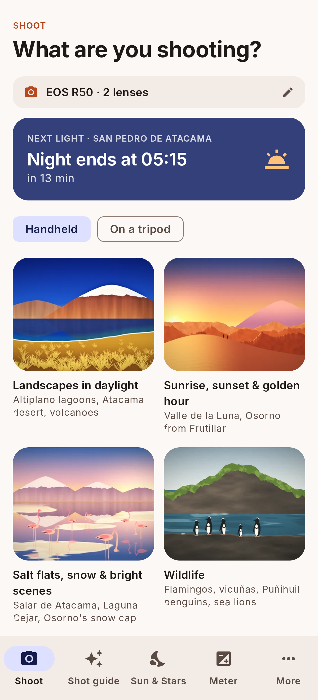
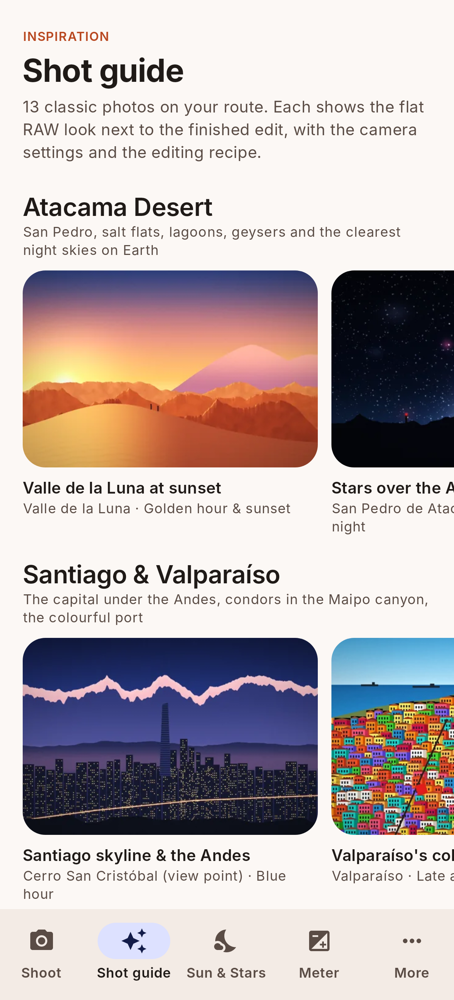
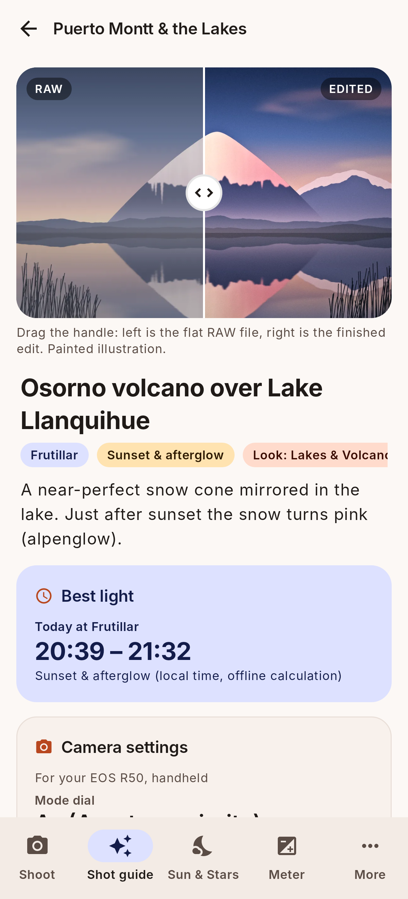
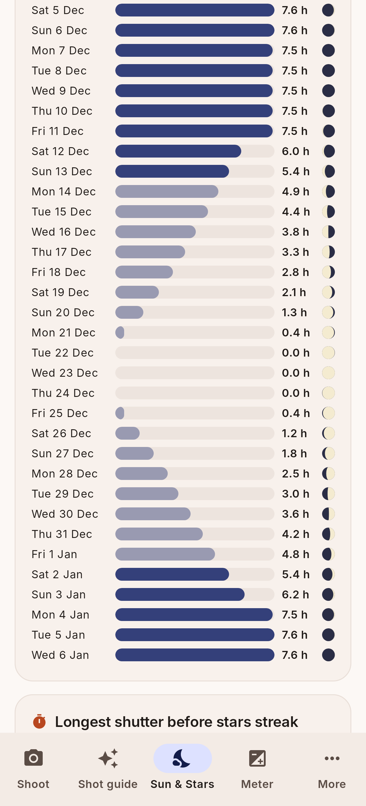

# Camera Coach · Chile

An Android app that tells you exactly how to set your Canon camera on a trip through Chile
(Atacama, Santiago & Valparaíso, Puerto Montt & the Lake District), shows you example shots with
the settings and editing recipes behind them, and helps you edit the photos afterwards.
Everything works **offline**.

| Shoot | Shot guide | Before / after | Star calendar |
|---|---|---|---|
|  |  |  |  |

## Features
- **Shoot**: 13 situations (Altiplano lagoons, Valle de la Luna, flamingos, condors, Petrohué falls,
  Milky Way, Santiago at blue hour, rainforest…). For each one: the mode dial, aperture, shutter, ISO, focus,
  white balance and more, calculated for *your* camera body and lens, with a one-line "why" for each setting.
  A live card shows the next golden hour, blue hour or sunrise where you are.
- **Shot guide**: 13 iconic photos on the route, each with a draggable RAW-vs-edited comparison,
  live "best light" times for that exact spot, camera settings for your gear, composition steps, the
  in-camera JPEG look, and the matching editing recipe.
- **Sun & Stars**: golden and blue hour, moon phase, moonrise and moonset, when the Milky Way centre,
  Carina Nebula and Magellanic Clouds are up in a dark sky, and a **45-night star calendar**.
- **Meter**: the phone's light sensor as a light meter for manual mode, plus an ND-filter calculator.
- **More**: your gear, files & storage (RAW vs JPEG, CR3/CR2, card calculator, backups),
  **editing & presets** (workflow, software comparison, 7 warm looks), trip checklist, camera basics.

## Lightroom presets
The 7 looks used in the app are in [`presets/`](presets) as Adobe Lightroom / Camera Raw `.xmp` presets
(they can also be shared straight from the app). Import them in Lightroom Classic via
*Develop → Presets → + → Import Presets*.

## Install on your phone
1. On your Android phone, open this repository's **Releases → Latest build**.
2. Tap `CameraCoach.apk` to download it, then open it (allow "install unknown apps" if asked).

Every push builds a new APK automatically (`.github/workflows/build.yml`). New builds install over the
old one and keep your settings.

## For developers
- Kotlin + Jetpack Compose (Material 3), min Android 8.0. No network permission needed.
- `./gradlew testDebugUnitTest`: logic tests (astronomy, advice, content, XMP validity).
- `./gradlew testDebugUnitTest -Pscreenshots`: renders every screen to `app/screenshots/` (Robolectric + Roborazzi).
- `./gradlew testDebugUnitTest -PexportPresets`: regenerates `presets/*.xmp`.
- `python3 tools/art/render.py`: repaints the example illustrations (numpy + Pillow); they are painted from code,
  not photographs.
- `./gradlew assembleRelease`: builds the APK.

Inter typeface © The Inter Project Authors, SIL Open Font License 1.1 (see `licenses/`).
