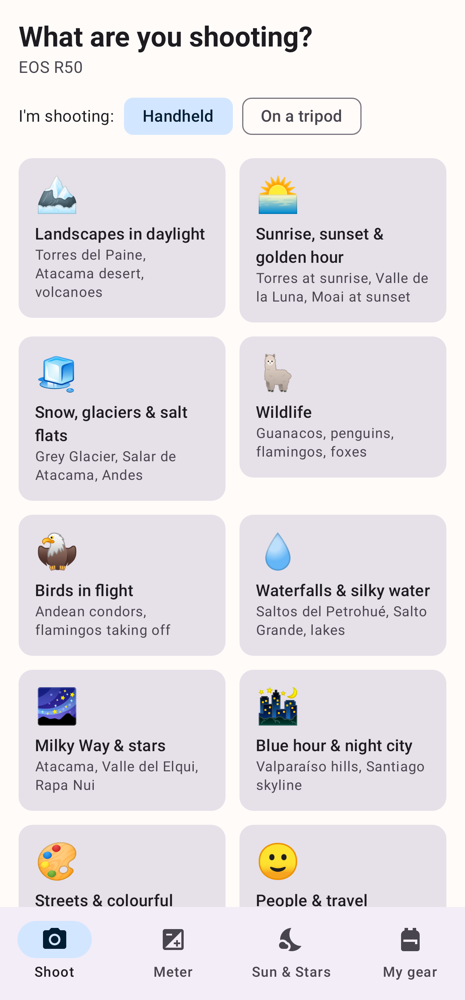
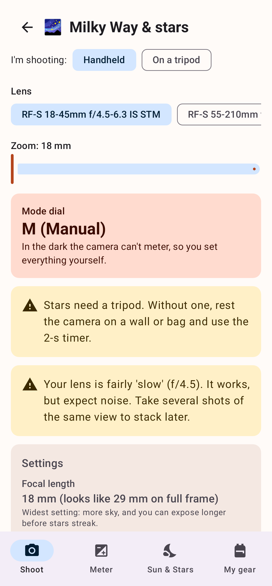
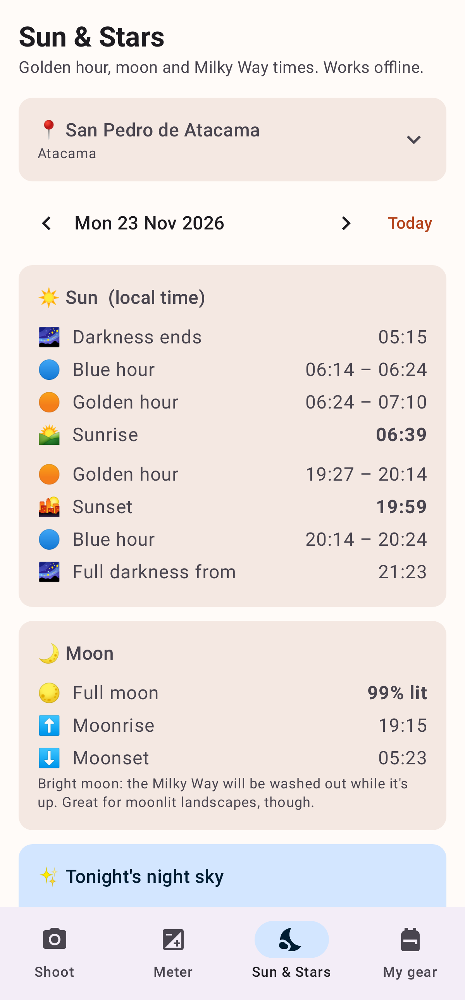

# Camera Coach (Chile edition)

An Android app that tells you what settings to use on your Canon camera, made for a trip to Chile.
It works fully **offline**.

| Shoot | Astro advice | Sun & Stars |
|---|---|---|
|  |  |  |

## What it does
- **Shoot**: pick a situation (landscape, Milky Way, guanacos, condors, waterfalls, El Tatio…) and get the
  mode dial, aperture, shutter, ISO, focus, white balance and more for *your* camera body and lens,
  each with a one-line "why", plus local tips.
- **Meter**: use the phone's light sensor as a light meter for manual mode, plus an ND-filter calculator.
- **Sun & Stars**: sunrise, golden and blue hour, moon phase, moonrise and moonset, and when the Milky Way,
  Carina Nebula and Magellanic Clouds are up in a dark sky. Uses preset Chilean locations or GPS.
- **My gear**: choose your Canon body and the lenses you're bringing.

## Install on your phone
1. On your Android phone, open **Releases → Latest build** on this repository's GitHub page.
2. Tap `CameraCoach.apk` to download it, then open it.
3. If asked, allow your browser to "install unknown apps".

Every push builds a new APK automatically (see `.github/workflows/build.yml`). New builds install over the
old one and keep your settings.

## For developers
- Kotlin + Jetpack Compose, min Android 8.0.
- `./gradlew testDebugUnitTest`: logic tests.
- `./gradlew testDebugUnitTest -Pscreenshots`: renders the screens to `app/screenshots/`.
- `./gradlew assembleRelease`: builds the APK.
