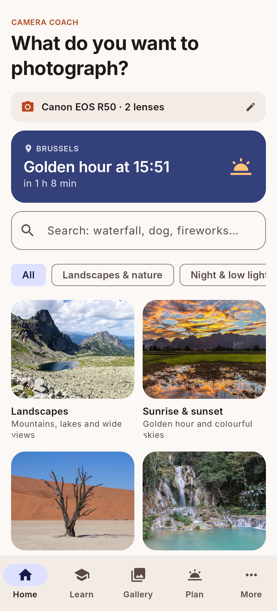
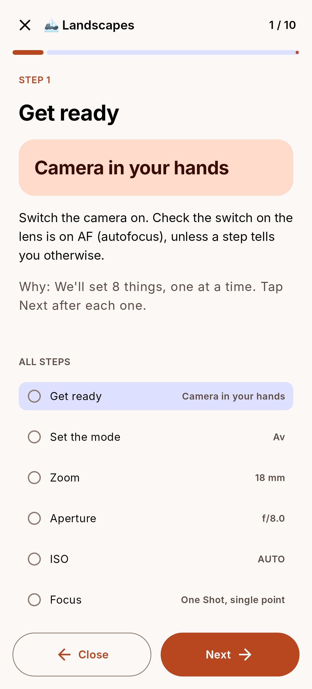
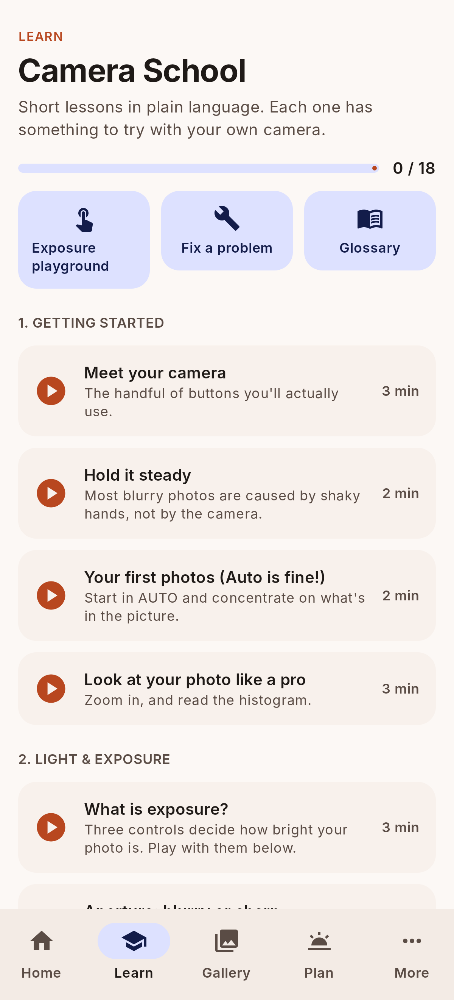
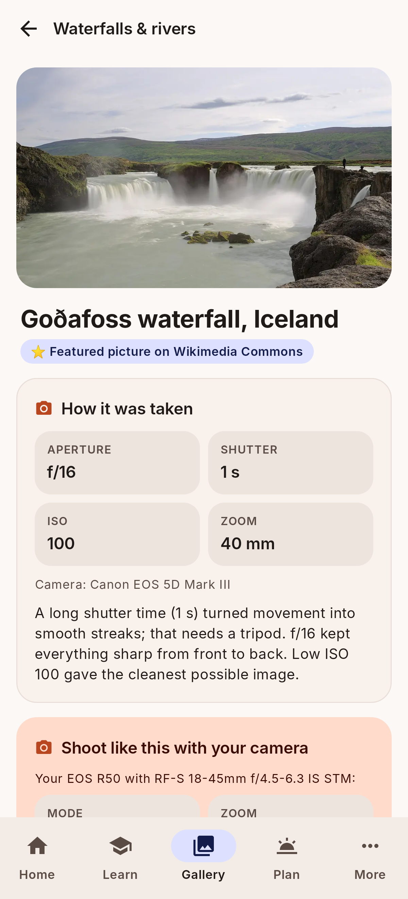

# Camera Coach

An Android app that teaches you photography with **your own camera**, anywhere in the world.
Made for beginners (and their parents): it tells you exactly which buttons to press, explains why,
and grows with you. Everything works **offline**.

| Home | Step-by-step guide | Camera School | Real photos, real settings |
|---|---|---|---|
|  |  |  |  |

## What's inside
- **Home**: 20 situations (landscapes, sunsets, waterfalls, stars, northern lights, city at night,
  fireworks, wildlife, birds, sports, pets, portraits, food…). For each one: the settings for *your*
  camera and lens, a **"Guide me step by step"** mode with one instruction per screen using your brand's
  own button names, tips, and "if it goes wrong". A live card shows the next golden or blue hour where you are.
- **Learn – Camera School**: 18 short lessons in 6 units, each with a "try it with your camera" exercise
  and a quick quiz. Plus an interactive **exposure playground**, a **problem solver**
  ("my photos are blurry / too dark / orange…") and a glossary.
- **Gallery**: 39 award-winning photos (Wikimedia Commons *Featured* and *Quality* pictures) with the
  real settings they were taken with, a plain-language explanation, and **"shoot like this with my camera"**,
  which translates those settings to your own camera and lenses.
- **Plan**: golden hour, blue hour, sunrise, sunset, moon and Milky Way times for **any place in the world**
  (34,000 cities and famous photo spots, or GPS), plus a 45-night star calendar.
- **More**: light meter, depth-of-field calculator, trip checklist, files & backups, editing guide with
  7 Lightroom presets, and **settings for parents: Simple mode and bigger text**.

**Cameras:** 85 models from Canon, Nikon, Sony, Fujifilm, Panasonic and OM System/Olympus,
plus "I don't know my model" options by sensor size, and 103 lenses.

## Install on your phone
1. On your Android phone, open this repository's **Releases → Latest build**.
2. Tap `CameraCoach.apk` to download it and open it (allow "install unknown apps" if asked).

Every push builds a new APK automatically (`.github/workflows/build.yml`). New builds install over the
old one and keep your settings.

## For developers
- Kotlin + Jetpack Compose (Material 3), min Android 8.0. No internet permission needed.
- `./gradlew testDebugUnitTest`: logic tests (advice for every camera/lens/scene, astronomy, content, presets).
- `./gradlew testDebugUnitTest -Pscreenshots`: renders every screen to `app/screenshots/` (Robolectric + Roborazzi).
- `python3 tools/photos/search.py DIR` + `tools/photos/select.py`: find rated photos and regenerate `Photos.kt`.
- `python3 tools/places/build_places.py GEONAMES_DIR app/src/main/assets`: rebuild the offline place database.
- `./gradlew assembleRelease`: builds the APK.

Photo, data and font credits: see [CREDITS.md](CREDITS.md).
